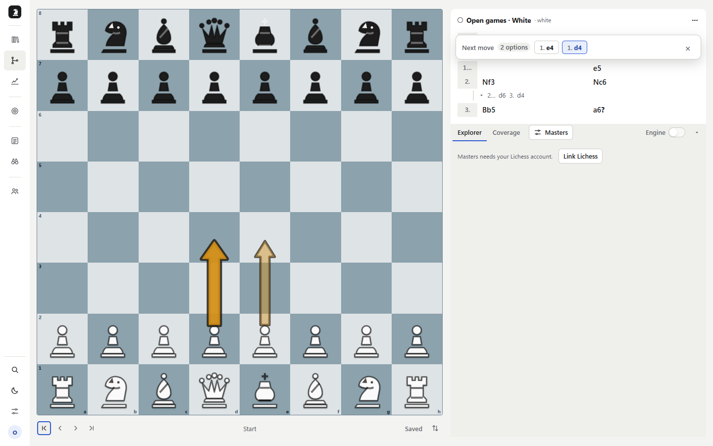
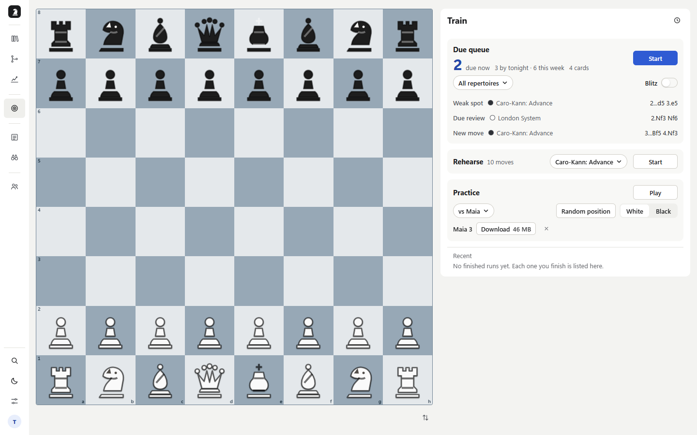
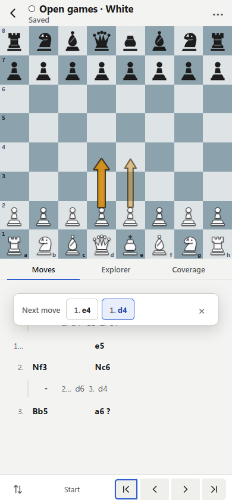

# 開始使用 PrepForge

[產品介紹](README.zh-TW.md) · [文件目錄](README.md) · [開啟 PrepForge](https://prepforge-w0c5.onrender.com)

介面目前使用英文，本指南保留畫面上的名稱，方便對照。
從一份短棋譜開始，完成一輪練習，再檢查一局實戰。

## 1. 建立第一份棋譜

登入後開啟 Library，選 New repertoire，輸入名稱並選執子顏色。
已有棋譜時也可以用 Import PGN 匯入。

開啟棋譜，在棋盤上下幾手你想準備的開局。例如準備黑棋的 Caro-Kann，
可以先輸入 `1. e4 c6 2. d4 d5 3. e5 Bf5`。
回到較早局面，再下一個不同的走法，就會建立分支。

右側走法樹可以切換局面；Explorer 的 Masters／Players 提供對局統計。
需要延伸時，從棋譜的 ⋯ 選單選 Generate moves。
等待 Saved 後返回 Library，再開啟一次，確認內容已儲存。

## 2. 完成一輪訓練

開啟 Train，先在 Due queue 選擇要練的棋譜範圍，再按 Start。
程式會走對手的棋，輪到自己時，在棋盤上下出準備過的回應。
想不起來可以使用提示；完成後查看本輪結果。

其他訓練方式：

| 模式 | 操作 |
| --- | --- |
| Rehearse | 選一份棋譜，按 Start，逐線練習自己的走法 |
| Practice | 選 Maia、Lichess Explorer 或自己的棋譜作為對手來源，再按 Play |
| Blitz | 在 Due queue 開始前打開開關，每手限時 10 秒 |

Practice 的對局可以用 Analyze 帶進分析工作區。
History 記錄此帳號在目前瀏覽器完成的 Due queue／Blitz 訓練；
這份歷史紀錄不跨裝置同步，清除網站儲存空間會一併刪除。

## 3. 對照一局實戰

在 Settings 連結 Lichess 帳號，再到 Games 新增自己的對局來源。
選擇樣本數後按 Check，開啟一局查看 Preparation detail。

| 結果 | 下一步 |
| --- | --- |
| You left prep | 查看原本的回應，用 Train 複習忘記的走法 |
| Opponent novelty | 檢查對手新招，決定是否補進棋譜 |
| Not covered | 回到棋譜，準備這個尚未覆蓋的局面 |

要看整局，選 Analyze。也可以在 Analyze 貼上 PGN，從輸入框右下角選 Open PGN；
同處的 File 可開啟 PGN 檔案。再按 Review 執行整局分析後，
查看走法分類、評估曲線與轉折點。候選變化會加入走法表；點選原局走法即可
回到原局，使用棋盤下的箭頭或鍵盤 ←／→ 逐手瀏覽。
展開 Game Report 查看大字的雙方準確率與階段數據，再用圖形標記雙方失誤及其影響；
點選標記查看該步，展開 Move grades 查看完整分類統計。
Past analyses 中，已識別執子方的對局用 +／−／= 表示勝／負／和。

## 4. 補上一個缺口

回到棋譜的 Coverage，選掃描範圍與 Horizon，再按 Scan。
從缺口清單挑一個局面，預覽回應；確認內容後才加入棋譜。
等待 Saved，再回 Train 練習新增的準備。

## 針對對手與分享

Scout 可以新增對手的 Lichess 來源，依顏色與棋速查看常走路線。
With White／With Black 指對手的執子方；加入準備時，選相反顏色的棋譜。
先檢查路線詳情，再用 Add to prep 選目標棋譜。

Library 的棋譜選單提供分享入口，Teams 管理團隊與共享棋譜。
對個人與團隊可設定 View only、Can copy 或 Can edit。
公開連結只提供瀏覽或複製；有複製權限時，接收者可選 Copy to my account，
再編輯自己的副本。

## 手機操作與引擎準備

手機棋盤頁用 Views 開啟全域導覽；Scout、Teams、Settings 位於 More。
棋譜的走法樹與 Explorer／Coverage 以頁籤切換。

首次使用 Stockfish 或 Maia3 時，依畫面下載引擎資源。
若顯示引擎無法使用，先到 Settings 檢查下載與引擎狀態，再依錯誤提示處理。
自行架設時，請核對[模型網址與跨來源隔離設定](DEPLOYMENT.md)。

本指南的入口名稱已對照目前原始碼與桌面／手機測試畫面。
完整操作驗證的範圍另見 [2026-10-08 操作紀錄](user-operations.md#驗證範圍)；
該紀錄的部分舊入口名稱與本指南不同。
